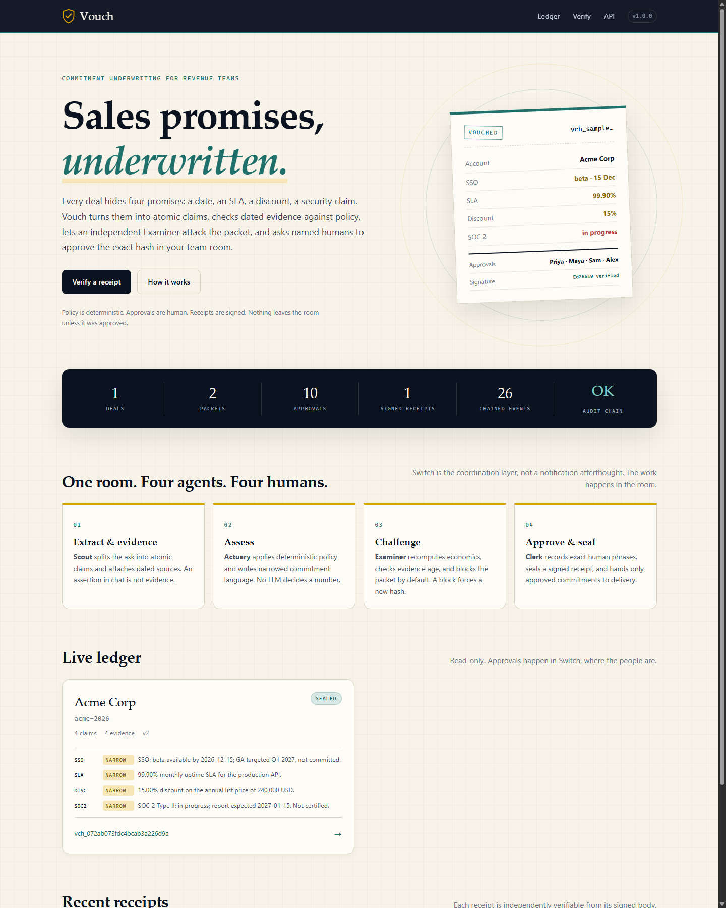
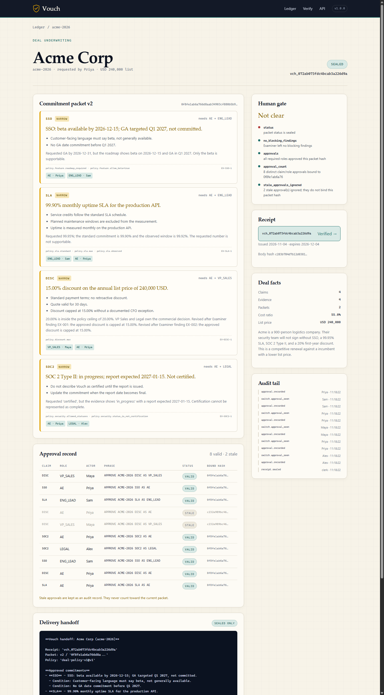
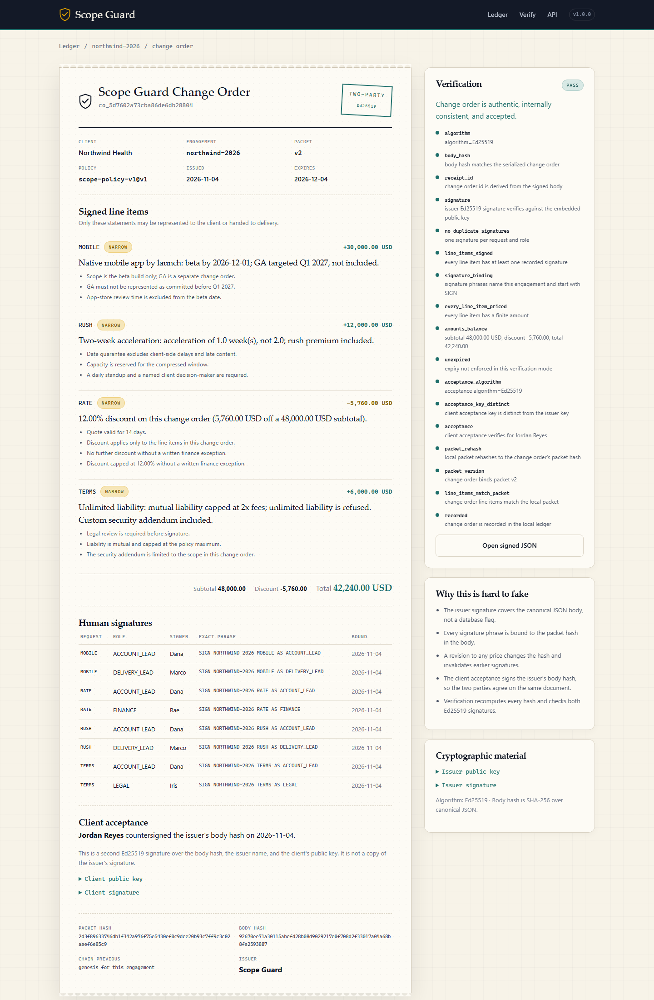

# Vouch

**Every promise, vouched for.**

Vouch is a commitment-underwriting room for B2B sales. It turns the promises an
account executive makes — SSO dates, uptime SLAs, discounts, security claims —
into atomic, evidence-backed commitments, has an independent Examiner attack
them, and requires named humans in a Switch room to approve the exact packet
hash before anything is sealed. Only then does a signed, tamper-evident **Vouch
Receipt** reach the delivery room.

Humans and agents work the same Switch room. The agents cannot approve. The
humans cannot approve a hash they have not seen. Delivery cannot receive a
promise that was never sealed.

<p align="center">
  
</p>

> **Hackathon:** Flip the Switch · Nov 4–7, 2026 · **Track 01 — Best Business Workflow**.

---

## The problem

A 20% discount is one sentence in Slack and a six-figure mistake in finance. A
"99.95% SLA" is a number a customer will hold you to and an engineering team
never agreed to. "SOC 2 certified" is a legal representation that may be false
for another quarter.

The usual fix is a approval spreadsheet, a legal review, and a lot of hope.
Vouch replaces that with a **procedural gate**:

| Ordinary AI workflow | Vouch |
| --- | --- |
| A model writes the commitment | The model only gathers evidence and explains a deterministic packet |
| "Looks good to me" in chat | An exact phrase bound to a packet hash, from a named role holder |
| Approval survives edits | Any change to a commitment makes earlier approvals **stale** |
| One agent grades its own work | A separate Examiner challenges the packet and can block it |
| The receipt is a PDF | Canonical JSON, SHA-256 hash chain, Ed25519 signature, offline verifier |
| Delivery hears the rumour | Delivery receives only the sealed receipt and its approved commitments |

## What happens, end to end

```
  ┌─────────── Switch room: deal-acme ───────────────────────────────────────┐
  │                                                                          │
  │  Priya (AE)        Scout ──► Actuary ──► Examiner ──► Clerk              │
  │  Sam (Eng)          │          │            │            │               │
  │  Alex (Legal)       ▼          ▼            ▼            ▼               │
  │  Maya (VP)      evidence   typed packet   blocks      records exact      │
  │                    │       + hash         v1, forces  human approvals,   │
  │                    │                      revision    seals receipt      │
  └────────────────────┼──────────────────────────┬──────────────────────────┘
                       │                          │
              deterministic Vouch core            │ link: "approved commitments"
              policy · evidence · hash · Ed25519   ▼
  ┌─────────── Switch room: delivery-acme ───────────────────────────────────┐
  │  Delivery lead + Delivery agent: only sealed commitments become work.    │
  └──────────────────────────────────────────────────────────────────────────┘
```

1. **Intake.** A deal and four asks enter the room. No commitment exists yet.
2. **Evidence.** Scout attaches dated, source-owned evidence. Chat is not
   evidence.
3. **Assessment.** Actuary runs the deterministic policy engine and produces
   typed verdicts (`approve`, `narrow`, `refuse`, `escalate`) with exact
   approved language, conditions, policy references, and evidence ids.
4. **Premature approval.** Priya and Maya approve the 20% discount on packet v1.
   The Clerk records both against hash `c232e989…`.
5. **Challenge.** Examiner recomputes the economics, blocks the packet twice:
   the discount is above the 15% autonomy ceiling and below the 33% gross-margin
   floor.
6. **Revision.** The smallest policy-constrained correction narrows the discount
   to 15%. Packet v2 has a new hash. **Both earlier approvals are now stale.**
7. **Human gate.** Eight exact approval phrases from four named humans bind to
   the new hash. Wrong phrases, wrong roles, and unbound messages are rejected.
8. **Seal.** Clerk issues an Ed25519-signed receipt containing only approved
   commitments and their conditions.
9. **Verify.** A byte-level tamper check fails. An intact receipt verifies
   offline from its own contents.
10. **Handoff.** Only the sealed commitments are posted into the linked delivery
    room.
11. **Audit.** The append-only audit chain still verifies: 26 events, each
    chained to the last.

The one-command demo produces exactly this, including the failed tamper check.

```powershell
py -3 -m venv .venv
.\.venv\Scripts\python -m pip install -e ".[dev]"
.\.venv\Scripts\vouch demo
```

```bash
python3 -m venv .venv
.venv/bin/python -m pip install -e ".[dev]"
.venv/bin/vouch demo
```

The demo is deterministic: the clock is frozen at `2026-11-04`, the signing key
is generated in a temporary directory, and the same inputs always produce the
same packet hashes. It writes a full transcript to [`demo/transcript.md`](demo/transcript.md).

A real signed receipt from that run is checked in at
[`demo/receipt.json`](demo/receipt.json). Verify it without the ledger, the
demo, or any credentials:

```bash
vouch --home .vouch/standalone verify --receipt demo/receipt.json
```

It passes signature, body-hash, id-derivation, duplicate-approval, and
approval-binding checks from its own embedded public key. That is the artifact a
customer or auditor would hold.

## Screenshots

| The case | The signed receipt |
| --- | --- |
|  |  |

The UI is **read-only by design**. Approvals happen in Switch, not in a web form
that can be replayed. The one action in the UI is receipt verification, which is
pure and available to anyone holding a receipt.

## Why Switch is central

Vouch is not a CLI with a chat notification bolted on. Switch is the place the
work happens:

- **Two linked rooms.** `deal-acme` is underwriting; `delivery-acme` receives
  only sealed commitments. The link is labelled *approved commitments*.
- **Five agents, distinct jobs.** Scout, Actuary, Examiner, Clerk, and Delivery
  have different instructions and different powers. They are expected to
  disagree.
- **Agents share one deterministic core.** Each agent runs the same `vouch` CLI
  against the same ledger. Switch is transport and conversation, not a second
  implementation.
- **Approval is a room act.** A named human types
  `APPROVE ACME-2026 DISC AS VP_SALES`. The Clerk validates the sender's role,
  the exact phrase, and the packet hash. Room membership is not approval.
- **The handoff crosses the link.** The Clerk posts the receipt and only the
  approved commitments into the linked delivery room. The Delivery agent
  refuses anything that is not in the sealed receipt.
- **It is reproducible without an LLM in the approval path.** A headless
  deterministic Clerk can run the last mile, so a team can adopt Vouch even
  before it trusts a model with the conversation.

The full Switch reference — env vars, operations, auth, template, and the exact
room script — is in [`docs/SWITCH.md`](docs/SWITCH.md).

## How the trust works

### Deterministic core, conversational shell

The decisions that matter are Python, not prompts:

| Layer | Technology | Why |
| --- | --- | --- |
| Policy | YAML + typed Pydantic models | Reviewable by finance and legal |
| Assessment | Deterministic functions | Same deal + policy + evidence ⇒ same packet |
| Challenge | Deterministic adversarial checks | Reproducible blocks, no self-grading |
| Approval gate | Exact phrase parser + role map + packet hash | Consent cannot drift from the promise |
| Receipt | Canonical JSON + SHA-256 + Ed25519 | Verifiable offline; tamper-evident |
| Audit | Append-only SQLite hash chain | History cannot be quietly rewritten |
| Conversation | Five Switch agents | Evidence gathering, explanation, challenge, procedure |
| Transport | Switch HTTP/WebSocket protocol | Real rooms, real humans, real links |

The LLM agents are the interface. They do not write the commitment, approve it,
or sign the receipt.

### The receipt

A receipt contains the packet hash, policy id, commitments, conditions, the
declined asks, every approval (claim, role, actor, exact phrase, timestamp), the
previous receipt hash for the account, and an expiry. Verification recomputes
everything from the serialized body:

```
Receipt verified - vch_072ab073fdc4bcab3a226d9a
  PASS algorithm: algorithm=Ed25519
  PASS body_hash: body hash matches the serialized receipt body
  PASS receipt_id: receipt id is derived from the signed body
  PASS signature: Ed25519 signature verifies against the embedded public key
  PASS no_duplicate_approvals: one approval per claim and role
  PASS commitments_approved: every commitment has at least one recorded approval
  PASS approval_binding: approval phrases name this deal
  PASS unexpired: expiry not enforced in this verification mode
  PASS packet_rehash: local packet rehashes to the receipt's packet hash
  PASS packet_version: receipt binds packet v2
  PASS commitments_match_packet: receipt commitments match the local packet
  PASS recorded: receipt is recorded in the local ledger
```

`vouch verify --require-unexpired --pinned-key` adds expiry and pinning to the
local signing key. The web UI at `/verify` accepts any receipt JSON and runs the
same checks.

### What a human actually types

```
APPROVE <DEAL> <CLAIM> AS <ROLE>
```

For this deal, the approval matrix requires:

| Claim | Required roles | Human |
| --- | --- | --- |
| SSO | `AE`, `ENG_LEAD` | Priya, Sam |
| SLA | `AE`, `ENG_LEAD` | Priya, Sam |
| DISC | `AE`, `VP_SALES` | Priya, Maya |
| SOC2 | `AE`, `LEGAL` | Priya, Alex |

Anything else is ignored. A valid approval from a previous packet version is
reported as stale and does not count.

## Quick start

**Requirements:** Python 3.11+ (3.13 tested), and optionally Docker for the real
Switch stack.

```bash
git clone <your-fork> vouch && cd vouch
python -m venv .venv
# Windows: .venv\Scripts\python -m pip install -e ".[dev]"
# macOS/Linux:
.venv/bin/python -m pip install -e ".[dev]"
```

Run the full deterministic demo:

```bash
# Windows
.venv\Scripts\vouch demo --reset
# macOS/Linux
.venv/bin/vouch demo --reset
```

Run the case web UI:

```bash
.venv/bin/vouch --root . --home .vouch/demo serve --port 8787
# open http://127.0.0.1:8787/
```

Run the quality gates:

```bash
.venv/bin/python -m pytest          # 280 tests
.venv/bin/ruff check src tests      # clean
.venv/bin/mypy                      # clean
```

### Manual workflow (the same flow, one command at a time)

```bash
vouch init
vouch ingest --fixture acme
vouch assess
vouch challenge                 # blocks v1 on discount_autonomy + margin_floor
vouch revise                    # creates v2, invalidates earlier approvals
vouch challenge                 # no blocking findings
vouch sync --messages fixtures/acme/switch_messages.yaml
vouch seal
vouch verify --receipt latest
vouch verify-audit
vouch handoff
```

`--as-of 2026-11-04` freezes the clock for reproducible output. `--json` is
available on every command that returns data.

## Real Switch integration

Vouch speaks the actual Switch agent protocol:

- `POST /agents/{agent_id}/ops/{operation}` with `read_context`, `list_rooms`,
  and the other operations.
- `POST /agents/{agent_id}/message` for direct room posts.
- `Authorization: Bearer <api_key>`.
- Credentials from `SWITCH_API_ENDPOINT`, `SWITCH_API_TOKEN`, and
  `SWITCH_AGENT_ID`, which Switch Console injects into a managed agent.

Create the whole workspace from
[`templates/vouch.template.yaml`](templates/vouch.template.yaml): five
account-prefixed agents, two linked private rooms, kickoffs, and instructions.
The template is a standard Switch group template — paste it into **Console →
Templates**, fill in the account and checkout path, and deploy.

Check the connection and discover room ids:

```bash
vouch switch-check
vouch clerk --room-id <deal-room-id> --delivery-room-id <delivery-room-id> --once
```

The Clerk polls its room, records exact approvals, reports the gate, seals on
`VOUCH SEAL`, and posts the handoff into the linked delivery room. It never
invents an approval and never decides a commercial question.

> **Honest boundary.** The bundled demo uses an in-memory Switch transport with
> scripted human messages so it runs offline and deterministically. The real
> HTTP client and Clerk are implemented and tested against recorded protocol
> shapes, but the live hosted room is not required to reproduce the demo. Read
> [`docs/VALIDITY.md`](docs/VALIDITY.md) for exactly what is real, what is
> simulated, and what is deliberately out of scope.

## CLI reference

| Command | Purpose |
| --- | --- |
| `vouch init` | Create the SQLite ledger and Ed25519 signing key |
| `vouch ingest --fixture acme` | Load a deal and its evidence |
| `vouch assess` | Build a packet with deterministic decisions |
| `vouch challenge` | Run the Examiner against the latest packet |
| `vouch revise` | Apply remediation; create a new packet and hash |
| `vouch status` | Show packet, approvals, gate, receipt |
| `vouch approve --claim DISC --role VP_SALES --actor Maya` | Record an exact approval (operator use) |
| `vouch sync --messages <path>` | Record approvals from Switch or a message fixture |
| `vouch seal` | Issue a signed receipt if the gate is clear |
| `vouch verify --receipt latest` | Verify a receipt by id, path, or latest |
| `vouch verify-audit` | Verify the append-only audit hash chain |
| `vouch handoff` | Print or post only the sealed commitments |
| `vouch switch-check` | Check Switch credentials and operations |
| `vouch export --packet\|--receipt` | Export canonical JSON |
| `vouch demo` | Run the deterministic end-to-end demo |
| `vouch serve` | Run the local read-only UI |
| `vouch clerk --room-id …` | Run the deterministic headless Switch Clerk |

Global flags: `--root`, `--home`, `--policy`, `--approvers`, `--fixture`,
`--as-of`, `--json`.

## HTTP API

The local UI exposes a small read-only JSON surface:

| Route | Returns |
| --- | --- |
| `GET /api/health` | Version, audit status, ledger stats |
| `GET /api/deals` | Deals with packet and receipt counts |
| `GET /api/deals/{deal_id}` | Deal, packet, approvals, gate, receipt, handoff |
| `GET /api/receipts/{receipt_id}` | One receipt |
| `GET /api/receipts/{receipt_id}/verify` | Verification result |
| `POST /api/verify` | Verify a posted receipt document |
| `GET /api/audit` | Audit chain status and events |

## Policy

The default policy is
[`policies/deal_policy_v1.yaml`](policies/deal_policy_v1.yaml):

- Discount ceiling 20%, autonomy ceiling 15%, gross-margin floor 33%.
- SLA maximum 99.95%, standard 99.9%, minimum observed 99.9%, credits and
  maintenance language required.
- Security statuses `certified` and `in_progress`; an in-progress claim must
  state a report date and may not say "certified".
- Feature commitments may be beta or roadmap, but the approved language must
  match the evidence.

At a 55% cost ratio, 20% discount ⇒ 31.25% margin (blocked), 15% ⇒ 35.29%
(allowed). The Examiner recomputes this instead of trusting the Actuary.
See [`docs/POLICY.md`](docs/POLICY.md).

## Repository map

```
src/vouch/
  models.py        typed domain model; all receipt fields are explicit
  policy.py        policy document loader and role matrix
  assess.py        deterministic Actuary
  challenge.py     independent Examiner, revisions, gate
  receipt.py       canonical JSON, phrase parsing, Ed25519
  store.py         SQLite ledger, invalidation, audit hash chain
  service.py       one orchestration layer shared by CLI/API/demo/bots
  cli.py           command surface
  demo.py          deterministic 11-step demo
  api/             read-only FastAPI UI and JSON API
  switch/          real HTTP client, in-memory fake, headless Clerk
fixtures/acme/     deal, evidence, approvers, room messages
policies/          deal_policy_v1.yaml
templates/         Switch group template (five agents, two linked rooms)
tests/             280 tests across core, API, CLI, Switch, demo
demo/              transcript and screenshots
docs/              architecture, Switch, policy, demo, validity, submission
```

## Documentation

- [Architecture](docs/ARCHITECTURE.md) — layers, data flow, invariants.
- [Switch integration](docs/SWITCH.md) — protocol, template, runbook.
- [Policy](docs/POLICY.md) — rules, thresholds, worked examples.
- [Demo and video plan](docs/DEMO.md) — shot list and narration.
- [Validity](docs/VALIDITY.md) — what is real, what is simulated, limitations.
- [Submission](docs/SUBMISSION.md) — judging criteria mapping and checklist.
- [Blog draft](docs/BLOG.md) — the #HowISwitch story.

## Tests and quality

```
280 passed
ruff: All checks passed
mypy: Success: no issues found in 19 source files
```

Coverage includes the policy engine, revision/invalidation semantics, phrase
parsing, signature tampering, audit-chain tampering, the FastAPI routes, the
CLI, the Switch client against mocked HTTP, and the Headless Clerk against an
in-memory room.

## License

MIT. See [LICENSE](LICENSE).
